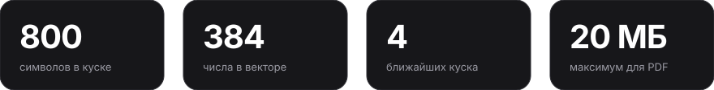
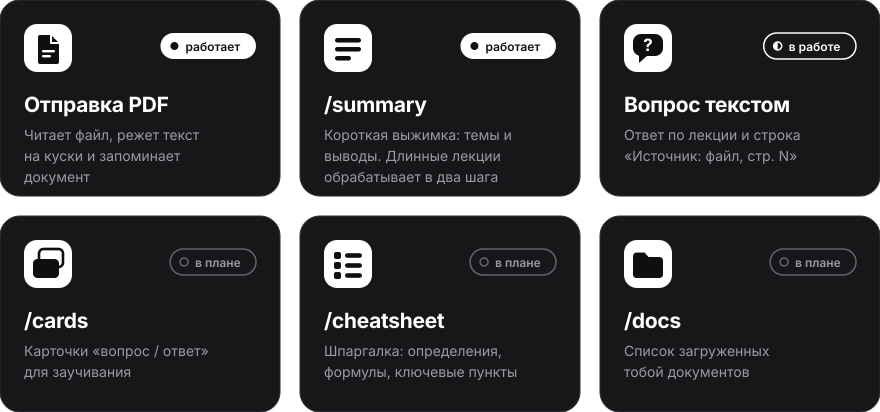
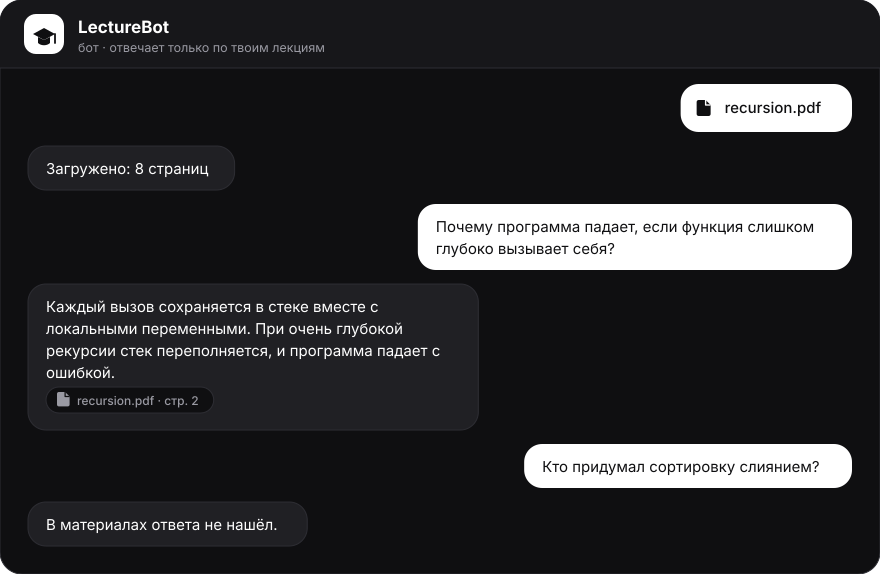
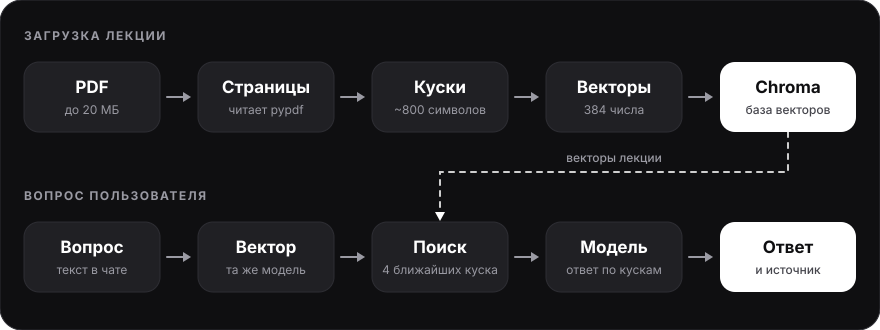
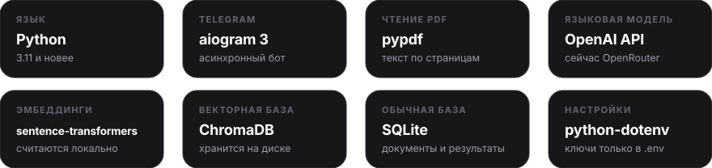
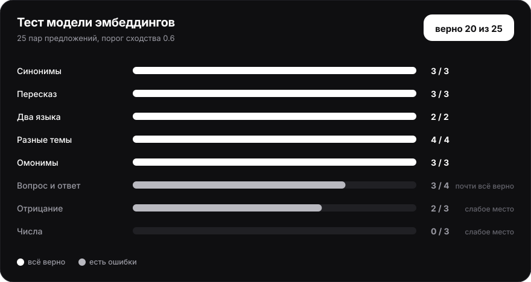
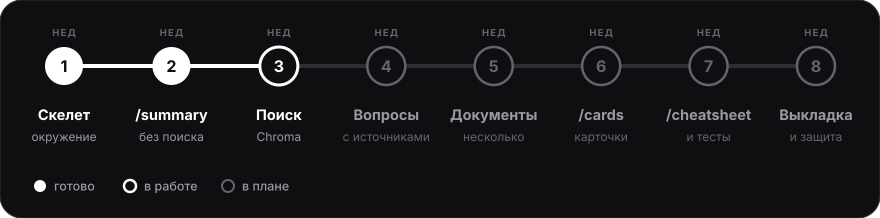
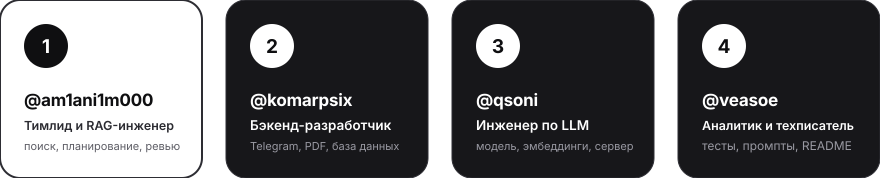

<p align="center">
  
</p>

<p align="center">
  
  
  
  
</p>

<p align="center">
  <a href="#features">Возможности</a> ·
  <a href="#start">Быстрый старт</a> ·
  <a href="#how">Как это работает</a> ·
  <a href="#quality">Качество</a> ·
  <a href="#roadmap">Дорожная карта</a> ·
  <a href="#team">Команда</a>
</p>

<br>

**LectureBot** это Telegram-бот для подготовки по лекциям. Ты отправляешь ему PDF, а он делает выжимку, отвечает на вопросы, составляет карточки для заучивания и шпаргалку.

Бот отвечает только по загруженным материалам и называет источник: файл и страницу. Если ответа в лекции нет, он так и скажет.



<br>

<a id="features"></a>




> [!NOTE]
> Бот читает PDF с текстовым слоем размером до 20 МБ. Сканы без текста он не поддерживает, распознавать текст на картинках мы не планируем.

<br>


Так будет выглядеть работа с вопросами, когда поиск заработает полностью:



<br>

<a id="start"></a>


```bash
gh repo clone am1ani1m000/lecture-bot
cd lecture-bot

python3 -m venv .venv
source .venv/bin/activate          # Windows: .venv\Scripts\activate
pip install -r requirements.txt

cp .env.example .env               # Windows: copy .env.example .env
# впиши в .env свои значения (таблица ниже)

python bot.py
```

После запуска найди своего тестового бота в Telegram и напиши `/start`. Модель для эмбеддингов скачается при первом обращении к ней.

Подробная инструкция для Linux, macOS и Windows с разбором частых ошибок лежит в [`docs/SETUP.md`](docs/SETUP.md).

| Переменная в `.env` | Что это |
|---|---|
| `BOT_TOKEN` | Токен тестового бота от [@BotFather](https://t.me/BotFather) |
| `LLM_API_KEY` | Ключ провайдера языковой модели (сейчас [OpenRouter](https://openrouter.ai), бесплатный) |
| `LLM_BASE_URL` | Адрес API, по умолчанию `https://openrouter.ai/api/v1` |
| `LLM_MODEL` | Модель, по умолчанию `openrouter/free` |
| `EMBED_MODEL` | Модель эмбеддингов, по умолчанию `sentence-transformers/paraphrase-multilingual-MiniLM-L12-v2` |

Провайдера и модель можно сменить в `.env`, код при этом не меняется. Сам файл `.env` в репозиторий не попадает.

<br>

<a id="how"></a>


Бот построен по схеме RAG: сначала найти, потом ответить. Лекцию целиком модели он не отправляет. Он находит в ней несколько подходящих кусков и просит модель ответить по ним.



1. **Загрузка.** PDF читается постранично, текст режется на куски примерно по 800 символов. Кусок не выходит за границу страницы, поэтому источник всегда точный.
2. **Векторы.** Локальная модель превращает каждый кусок в набор чисел, по которому тексты можно сравнивать по смыслу. Ключи для этого не нужны.
3. **Поиск.** Вопрос тоже превращается в вектор, и Chroma находит четыре ближайших куска.
4. **Ответ.** Языковая модель отвечает только по найденным кускам. Строку с источником собирает код бота из этих же кусков. Так модель не может назвать страницу, которой нет.

Архитектура и контракт между модулями описаны в [`docs/AI_PROMPT.md`](docs/AI_PROMPT.md), принятые решения лежат в [`docs/DECISIONS.md`](docs/DECISIONS.md).

<br>




<br>


```text
lecture-bot/
├── bot.py              Telegram-обработчики
├── documents.py        PDF → страницы → куски
├── search.py           поиск по смыслу (Chroma)
├── llm.py              языковая модель и эмбеддинги
├── db.py               SQLite: документы и сохранённые результаты
├── config.py           настройки и константы
├── prompts/            тексты промптов для модели
├── scripts/            проверочные скрипты и эксперименты
├── tests/              автотесты и оценка качества
└── docs/               установка, решения, эксперименты
```

<br>

<a id="quality"></a>


Качество бота мы проверяем на наборе вопросов с эталонными ответами. Он появится в `tests/eval/`. По нему считаем, как часто бот отвечает верно, как часто выдумывает и правильно ли называет источник.

| Показатель | Значение |
|---|---|
| Доля верных ответов | _после полного прогона_ |
| Доля выдуманных ответов | _после полного прогона_ |
| Верный источник | _после полного прогона_ |

Что уже проверено. Первым делом мы выбрали модель эмбеддингов и прогнали её на 25 парах предложений: синонимы и два языка она понимает хорошо, числа и отрицание хуже. Подробности в [полном отчёте](docs/experiments/embeddings_test.md).



Второй эксперимент это [мини-поиск по лекции](docs/experiments/mini_search.md): нужный кусок попадает в четвёрку лучших, даже если вопрос сформулирован другими словами.

<br>

<a id="roadmap"></a>




<br>

<a id="team"></a>




<p align="center">
  <a href="https://github.com/am1ani1m000">@am1ani1m000</a> ·
  <a href="https://github.com/komarpsix">@komarpsix</a> ·
  <a href="https://github.com/qsoni">@qsoni</a> ·
  <a href="https://github.com/veasoe">@veasoe</a>
</p>

---

<p align="center">
  <sub>Учебный командный проект · 8 недель · 4 человека</sub>
</p>
